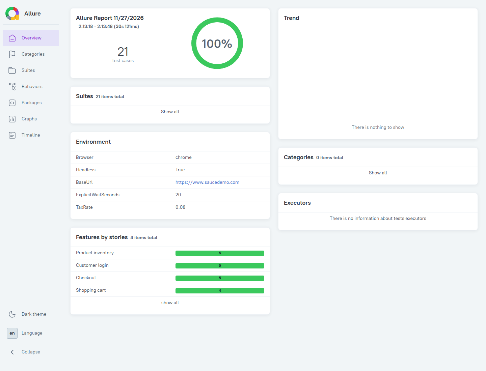

# Behave BDD E-commerce Tests

Portfolio project by [Vasyl Popovich](https://github.com/Potucky).

This is a portfolio demo, not code from an employer, and it is not affiliated with Sauce Labs. It is a BDD UI suite for the public [Sauce Demo](https://www.saucedemo.com) store (Swag Labs). The usernames and password are the ones printed on that site's login page. No secrets are stored in this repository.

[](https://github.com/Potucky/behave-bdd-ecommerce-tests/actions/workflows/ui-tests.yml)

[Live test report](https://potucky.github.io/behave-bdd-ecommerce-tests/)

## What this project demonstrates

- BDD with Gherkin: Behave features for login, inventory, cart, and checkout, including Scenario Outlines and tags (`@smoke`, `@negative`, `@sorting`)
- Page Object Model: Selenium page objects under `pages/`, with thin step definitions and a new browser for every scenario
- Validation of displayed totals: the backpack checkout asserts `$29.99`, tax `$2.40`, and total `$32.39`, then checks that line prices sum to the item total, tax is 8% rounded half-up to the cent, and the grand total is item total plus tax. `framework/test_money.py` covers that rounding without a browser
- Negative-path coverage: blank credentials, a wrong password, the locked demo account, and each missing checkout field
- CI test reports: GitHub Actions on every push to `main` and every pull request produces JUnit XML, an Allure HTML report, and failure screenshots. A push to `main` also publishes that HTML report to GitHub Pages

## Suite design

- A fresh browser per scenario, so cart and session state cannot leak
- Explicit waits on the result of an action (URL, button label, heading, error text, sort label)
- Configuration from environment variables (see `.env.example`)
- GitHub Actions on every push to `main` and every pull request: headless Chrome, JUnit XML, an Allure HTML report, and failure screenshots uploaded as one artifact

## Tech stack

| Tool | Role |
| --- | --- |
| Python 3.12 | Language |
| Behave 1.3 | BDD runner and Gherkin |
| Selenium 4 | Chrome automation. Selenium Manager resolves ChromeDriver |
| Allure Behave + Allure 2 | Results during the run, HTML report in CI |
| JUnit XML | Built-in Behave report, one file per feature |
| python-dotenv | Optional local overrides |
| GitHub Actions | CI |

## Project structure

```text
.github/workflows/ui-tests.yml   # push and pull_request test workflow
.github/workflows/pages.yml      # push to main: run the suite and publish the HTML report
behave.ini                       # JUnit output and runner defaults
config/settings.py               # environment configuration
framework/driver_factory.py      # Chrome session
framework/money.py               # price parsing and tax rounding
framework/test_money.py          # unit tests for that arithmetic
pages/                           # page objects (login, inventory, cart, checkout, header)
features/                        # Gherkin, environment hooks, step definitions
features/environment.py          # setup, teardown, screenshot on failure
docs/pages/index.html            # GitHub Pages landing page; links to the Allure report
docs/images/allure-overview.png  # report from a real local run
```

## Test approach

Each scenario starts Chrome, drives the public store, and closes the browser, including after a failure. Locators prefer the `data-test` attributes Sauce Demo publishes.

A click is followed by a wait for the UI change it should cause. If that change has not happened yet, the click is sent again. That covers a headless Chrome case where a pointer click can land on the control and still be ignored by the page. Login and checkout fields are React-controlled inputs: the suite types with `send_keys` and, when the DOM value does not stick, sets the value through the input's native setter and an `input` event. The step returns only when the field shows the expected value.

`standard_user` is the happy-path account. `locked_out_user`, a wrong password, and blank fields cover rejected login. Checkout covers a completed order, each missing required field, and cancel back to the cart.

The price and tax rules also have unit tests in `framework/test_money.py`, so the rounding can be checked without a browser.

Scenarios that would only add delay or a broken image are left out on purpose: `performance_glitch_user`, `problem_user`, `error_user`, and `visual_user`.

## Configuration

Copy `.env.example` to `.env` to override a value. The defaults already point at Sauce Demo, and existing environment variables win over `.env`, which is what CI uses.

| Variable | Default | Purpose |
| --- | --- | --- |
| `BASE_URL` | `https://www.saucedemo.com` | Store under test |
| `BROWSER` | `chrome` | Only Chrome is wired up |
| `HEADLESS` | `true` | `false` shows the browser window |
| `EXPLICIT_WAIT` | `20` | Seconds for each UI wait |
| `PAGE_LOAD_TIMEOUT` | `45` | Page load timeout in seconds |
| `WINDOW_WIDTH` / `WINDOW_HEIGHT` | `1440` / `1080` | Browser window |
| `SAUCE_USERNAME` | `standard_user` | Account for signed-in scenarios |
| `SAUCE_PASSWORD` | `secret_sauce` | Public demo password |
| `SAUCE_LOCKED_USERNAME` | `locked_out_user` | Locked demo account |
| `TAX_RATE` | `0.08` | Rate used by the overview check |
| `CHROME_BINARY` | empty | Optional path to Chrome |

## Run locally

Python 3.12 and Google Chrome are required.

```bash
python3 -m venv .venv
source .venv/bin/activate
pip install -r requirements.txt

# Full suite. Writes JUnit XML to reports/junit and Allure results to reports/allure-results.
make test

# The same runs without make:
python -m unittest discover -s framework -p "test_*.py"
behave --no-color -f pretty -o - -f allure_behave.formatter:AllureFormatter -o reports/allure-results

# A smaller set, with the window visible:
HEADLESS=false behave --tags=@smoke
behave --tags=@checkout
behave --tags=@negative
```

On Windows, activate `.venv\Scripts\activate` and set `HEADLESS` in the environment before the same `behave` command.

`behave` on its own (no extra formatters) still runs every scenario and writes JUnit XML, because that output is configured in `behave.ini`.

Allure's HTML report needs Java and the Allure 2.46.2 command line:

```bash
allure generate reports/allure-results --clean -o reports/allure-report
allure open reports/allure-report
```

`make allure` runs the generate step. Reports and screenshots under `reports/` are gitignored.

## Continuous integration

`.github/workflows/ui-tests.yml` runs on pushes to `main` and on pull requests. The job installs the pinned requirements, runs the money unit tests, runs Behave in headless Chrome, generates the Allure report, and uploads one artifact named `behave-test-reports`:

- `reports/junit` — JUnit XML
- `reports/allure-results` — raw Allure results
- `reports/allure-report` — HTML report
- `reports/screenshots` — PNG for each failed scenario, also attached to the Allure result

The badge above reads the workflow on the default branch, so it updates after this workflow is on `main`.

`.github/workflows/pages.yml` runs on a push to `main`. It runs the same unit tests and Behave suite, generates the Allure HTML report, and deploys that report with [docs/pages/index.html](docs/pages/index.html), which links to it. The published site is the [live test report](https://potucky.github.io/behave-bdd-ecommerce-tests/). GitHub Pages has to use **Source: GitHub Actions** for that deploy. This repository is already set that way. The workflow does not change repository settings.

## Sample output

Excerpt from a headless local run (login), then the full-suite summary:

```text
@login
Feature: Customer login # features/login.feature:2
  @smoke
  Scenario: Standard user signs in           # features/login.feature:8
    Given the login page is open             # features/steps/common_steps.py:10
    When the user logs in as "standard_user" # features/steps/login_steps.py:10
    Then the inventory page is displayed     # features/steps/common_steps.py:29
    And the products heading is "Products"   # features/steps/inventory_steps.py:12

  @negative
  Scenario Outline: Invalid credentials are rejected -- @1.1     # features/login.feature:30
    Given the login page is open                                 # features/steps/common_steps.py:10
    When the user logs in with username "" and password ""       # features/steps/login_steps.py:19
    Then the login error is "Epic sadface: Username is required" # features/steps/login_steps.py:27
    And the user remains on the login page                       # features/steps/login_steps.py:33

4 features passed, 0 failed, 0 skipped
21 scenarios passed, 0 failed, 0 skipped
109 steps passed, 0 failed, 0 skipped
Took 0min 24.262s
```

Allure overview from that same run:



## Coverage notes

| Area | What the suite checks |
| --- | --- |
| Login | Successful sign-in, logout, missing username, missing password, unknown password, locked account |
| Inventory | The six catalog names, a price and an Add to cart button on each, all four sort orders, backpack detail name and price |
| Cart | Badge count, cart contents, remove from the inventory, remove from the cart page |
| Checkout | Required first name, last name, and postal code; cancel returns to the cart; completed order confirmation; stated totals and the 8% tax formula |

21 scenarios, 109 steps. The money unit tests add the rounding cases (`$29.99` → tax `$2.40`, and half-up on `$15.99`) without opening a browser.

Left out on purpose: other browsers, mobile viewports, visual diffs, the Sauce Labs marketing links in the menu, and the demo users whose only behavior is a delay or a broken image.

## Author

Vasyl Popovich, QA Automation Engineer, Miami, FL. GitHub: https://github.com/Potucky
